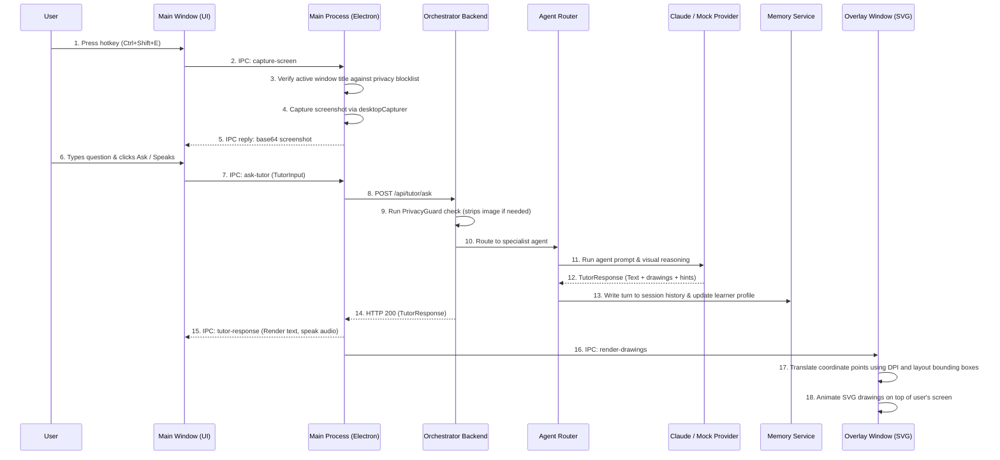
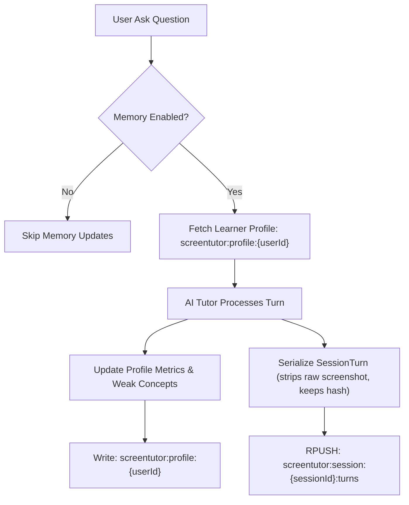
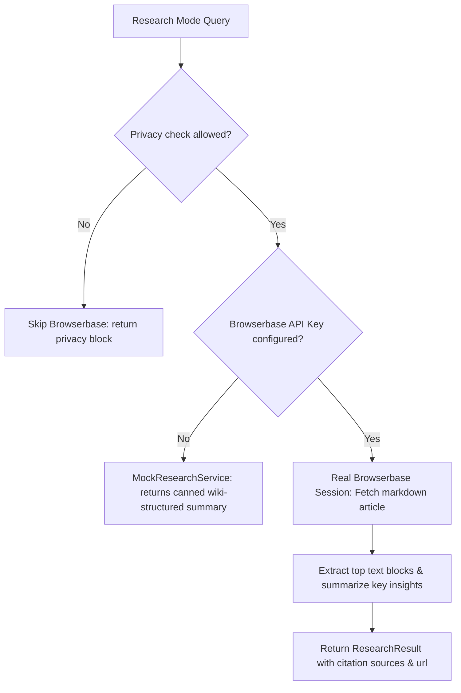
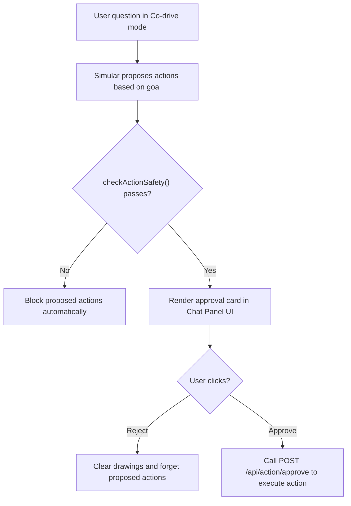

# System Architecture — ScreenTutor AI

This document provides a detailed breakdown of ScreenTutor AI's component architecture, data flows, and integration interfaces.

---

## 1. System Overview

ScreenTutor AI is a monorepo consisting of three main packages communicating over HTTP, Electron IPC, and Redis.

```mermaid
graph TB
    subgraph Desktop["Desktop App (Electron)"]
        MW["Main Window<br/>(React UI)"]
        OW["Overlay Window<br/>(Transparent SVG Overlay)"]
        MP["Main Process<br/>(IPC, Capture, Keyboard Hotkeys)"]
        MW <-->|IPC| MP
        OW <-->|IPC| MP
    end

    subgraph Orchestrator["Orchestrator Backend (Fastify)"]
        Router["Route Handler<br/>/api/tutor/ask"]
        AR["AgentRouter<br/>(specialist dispatchers)"]
        AIP["AI Provider<br/>(mock / anthropic / fetch)"]
        Mem["Memory Service<br/>(Redis / InMemory)"]
        BB["Browserbase Service<br/>(Headless Research)"]
        Sim["Simular Service<br/>(Action proposing)"]
        
        Router --> AR
        AR --> AIP
        AR --> Mem
        AR --> BB
        AR --> Sim
    end

    subgraph Shared["@screentutor/shared"]
        Schemas["Zod Schemas<br/>(drawing, tutor, memory, action, research)"]
        Redact["RedactionService<br/>(PII scrubbing, console patcher)"]
        Coord["Coordinates Utility<br/>(DPI & Multi-Monitor Math)"]
    end

    MP -->|HTTP POST /api/tutor/ask| Router
    Router -->|TutorResponse| MP
    MP -->|DrawingCommand[]| OW
    Shared -.->|imported by| Desktop
    Shared -.->|imported by| Orchestrator
```

---

## 2. Desktop App Architecture

The desktop app runs a multi-window Electron architecture.

```
┌──────────────────────────────────────────────────────────┐
│               ELECTRON MAIN PROCESS (Node.js)             │
│                                                          │
│  - Hotkey Manager (Ctrl+Shift+E)                         │
│  - desktopCapturer (Screen screenshot)                   │
│  - Privacy Manager (Window title checks)                 │
│  - Coordinate mapping (Display DPI & frame translation)  │
│  - IPC Dispatcher                                        │
└──────────────┬────────────────────────────┬──────────────┘
               │ IPC                        │ IPC
               ▼                            ▼
┌───────────────────────────┐  ┌───────────────────────────┐
│     MAIN WINDOW (UI)      │  │   OVERLAY WINDOW (SVG)    │
│                           │  │                           │
│  - React UI & Mode Tabs   │  │  - Transparent Canvas     │
│  - Chat panel             │  │  - SVG Shapes & Highlights│
│  - Microphone input (PTT) │  │  - Easing entrance anims  │
│  - Text-to-speech engine  │  │  - Automatic timer cleanup│
└───────────────────────────┘  └───────────────────────────┘
```

---

## 3. Orchestrator Backend Architecture

The API backend coordinates specialist tutor agents.

```
┌─────────────────────────────────────────────────────────────────┐
│                   FASTIFY SERVER (:4317)                        │
│                                                                 │
│  Routes:                                                        │
│  - POST /api/tutor/ask                                          │
│  - POST /api/research                                           │
│  - POST /api/action/approve                                     │
│  - GET/DELETE /api/memory/:userId                               │
└──────────────────────────────┬──────────────────────────────────┘
                               ▼
┌─────────────────────────────────────────────────────────────────┐
│                          AGENT ROUTER                           │
│  Routes requests based on query keywords or requested modes     │
└───────┬──────────────┬─────────────────┬─────────────────┬──────┘
        │              │                 │                 │
        ▼              ▼                 ▼                 ▼
┌──────────────┐┌──────────────┐┌────────────────┐┌────────────────┐
│  MathTutor   ││Misconception ││ QuizGenerator  ││ ResourceFinder  │
│    Agent     ││    Agent     ││     Agent      ││     Agent      │
└───────┬──────┘└──────┬───────┘└────────┬───────┘└────────┬───────┘
        │              │                 │                 │
        ▼              ▼                 ▼                 ▼
┌─────────────────────────────────────────────────────────────────┐
│                          INTEGRATIONS                           │
│  - AIProvider (Claude / MockClaude)                             │
│  - MemoryService (RedisMemoryService / InMemoryService)         │
│  - BrowserbaseIntegration (Headless browsing summaries)         │
│  - SimularIntegration (GUI click/keypress actions)              │
└─────────────────────────────────────────────────────────────────┘
```

---

## 4. System Data Flows

### General Tutor Request Flow



---

## 5. Sponsor Flow

Every sponsor technology follows an interface structure allowing dynamic mock fallbacks:

```
                  ┌──────────────┐
                  │ Config Env   │
                  │ Check        │
                  └──────┬───────┘
                         │
            Is key configured & enabled?
             /                        \
           YES                        NO
           /                            \
          ▼                              ▼
 ┌──────────────────┐          ┌──────────────────┐
 │  Real Service    │          │   Mock Fallback  │
 │  (API Requests)  │          │  (Local Template)│
 └──────────────────┘          └──────────────────┘
```

---

## 6. Memory Flow

Learner memory utilizes Redis namespaces for speed and segmentation.



---

## 7. Research Flow

Research mode utilizes headless browsing via Browserbase to summarize live references.



---

## 8. Action Approval Flow

Simular proposes desktop control actions securely using a strict approval loop:



---

## 9. Observability & Redaction Flow

Observability logs pass through a strict shared redaction layer:

```
   Raw Event (Console Log / Trace / Sentry Exception)
                       │
                       ▼
            ┌──────────────────────┐
            │   RedactionService   │
            │                      │
            │   Check Dev Override │
            │   Flag (on/off)      │
            └──────────┬───────────┘
                       │
          Is dev override enabled?
           /                      \
         YES                      NO
         /                          \
        ▼                            ▼
┌──────────────┐             ┌──────────────────────────────┐
│ Send Raw Data│             │ Scrub & Redact PII:          │
│ (For local   │             │ - sk-... API Keys            │
│  debugging)  │             │ - Emails / Phones / CCs      │
│              │             │ - Base64 Screenshots         │
│              │             │ - URL queries / Private titles│
└──────────────┘             └──────────────┬───────────────┘
                                            │
                                            ▼
                             ┌──────────────────────────────┐
                             │ Publish Redacted Payload to: │
                             │ - Console out logger         │
                             │ - Sentry crash events        │
                             │ - Arize Phoenix telemetry    │
                             └──────────────────────────────┘
```
